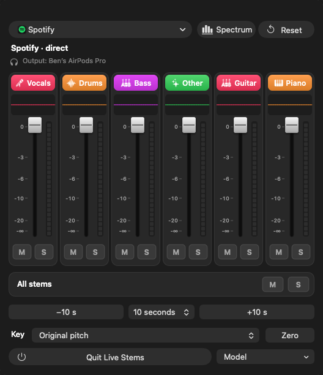
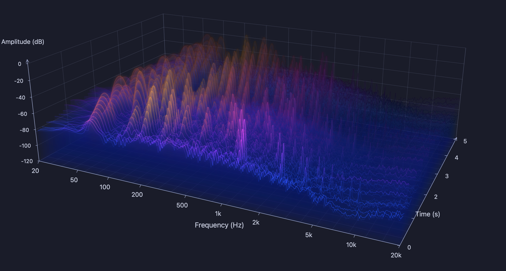
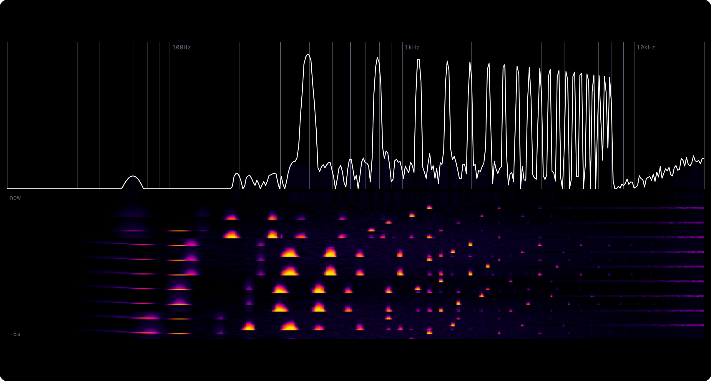

# Live Stems

**Separate the audio of any app on your Mac into vocals, drums, bass and everything else, live.**
Mute the vocals to study with instrumentals or sing along, solo the bass to learn a line, turn the
drums down to practice over them. It works while Spotify, Apple Music, a YouTube tab, VLC or any
other app is playing. Nothing is downloaded, prepared or saved: the separation happens as you listen.







Live Stems sits in your menu bar. Its panel has:

- a **source menu**: pick the app whose audio you want to split,
- one row per stem, like a Logic Pro track header: a **volume slider**, **M** (mute, blue) and
  **S** (solo, yellow) buttons, and a small **waveform** of what that stem is doing right now,
- an **All stems** row: **M** mutes everything, **S** lights up while anything is soloed (click it to
  clear every solo, like Logic),
- **Reset**, which puts every control back to normal.
- a **spectrum** button (next to Reset), which opens the Spectrum Analyzer.

## Test pitch and seek controls

This branch adds a **Key** menu from −12 to +12 semitones. It changes the pitch of
the final mix and keeps playback speed unchanged. **Zero** resets pitch alone.
**Reset** clears pitch and the stem controls. Pitch works with Original and stem mixes.

For Spotify, choose **5, 10, 15, or 30 seconds**, then click the backward or forward
button. Seeking preserves paused playback and clamps to the current track's bounds.
Seek status text is hidden in the panel. Other sources can use
pitch; their seek controls are disabled. The controls are local to this panel.

Build a separate copy with `bash script/build_test.sh` from this checkout. It uses
the existing Python environment, models, and signing identity in the workspace.
The default output is `../../outputs/live-stems-pitch-seek-test`. To retain another
test build, pass a new output-folder path. Existing output folders are never overwritten.

1. Pause your source player. Open **Launch Test.command** in the output folder.
   It asks the installed app to quit and opens **Live Stems Test**. It never forces a process to stop.
2. Allow audio capture and Spotify control if macOS asks. The test copy has its own app identity.
3. Select Spotify. Start a track and try **+2 semitones**, then **Zero**.
   Try a muted-vocal mix as well as Original. The song's speed should stay the same.
4. For each seek interval, try backward and forward. Try near the start/end, while
   paused, and two seeks in succession. Check that old audio does not return after a seek.
5. Open **Return to Installed.command** to quit the test copy and reopen the installed app.
   Pause the source first if the app is waiting to quit.

The test copy uses separate preferences and runtime logs. It shares the instance lock
with the installed app so they cannot both capture. The installed app is not replaced.
Automated tests render synthetic audio and use injected Spotify transport. Live music
quality, permissions, device changes, and actual Spotify transport still need manual checks.

## How it works

```
                       ┌─ Spotify
                       ├─ Apple Music
  the app you pick ────┼─ Chrome / Safari / YouTube
                       ├─ VLC, Logic
                       └─ any other app
                              │
                              ▼
                       macOS audio tap
                              │
                              ▼
                 last ~3 s, in memory only
                              │
                              ▼
          Demucs on your Mac's GPU, 10 times a second
                              │
                vocals · drums · bass · other
                              │
                              ▼
            your mix ──▶ speakers or headphones
```

1. **macOS hands Live Stems the sound of the app you picked**, the same way an equalizer or an audio
   visualizer gets it. Live Stems never opens the app's files or its stream.
2. **It keeps only the last few seconds**, in memory. Older audio is thrown away continuously.
3. **Ten times a second, the newest second goes through
   [Demucs](https://github.com/facebookresearch/demucs)**, Meta's music separation model, on your
   Mac's GPU. The model returns four stems.
4. **Your sliders remix the stems** and the result goes to your speakers or headphones, about a third
   of a second behind the app. The delay never changes, so you won't notice it.

If the model is ever late, that moment plays the parts of your mix that don't need stems instead of
glitching. When your mix is the plain song (every stem at the same volume) or the music is paused,
the model sleeps and your GPU rests.

## What Live Stems does not do

These are deliberate limits, not missing features:

- **It doesn't download, export or save audio or stems.** Only the last ~3 seconds exist, in memory.
- **It doesn't touch an app's files, cache, stream or copy protection.** It only hears what the app
  plays, through macOS.
- **It doesn't use any streaming service's API or SDK.** Spotify plays normally in its own app.
- **It doesn't train the model.** The model is used as downloaded (inference only).
- **Its logs hold timing numbers only**, never audio or song titles.

Streaming services' own terms of use still apply to how you use their content. This README is not
legal advice. Live Stems is meant for personal listening and practice; don't use it to copy or share
music.

## What you need

- A Mac with **Apple Silicon** running **macOS 14.2 or newer**. Tested on an **M3 Max** and a
  base **M1**. The model must finish each job in under 0.1 s. At launch Live Stems times itself and, on
  slower GPUs (M1, M2), switches to a lighter model that is a little less clean.
- **Python 3.12**: the installer finds it, or installs it with Homebrew.
- Apple's **Command Line Tools**, to build the app (`xcode-select --install` if you don't have them).
- About **1.5 GB of disk space** for the model and its Python packages (the download is about 0.6 GB),
  and about **1.5 GB of memory** while stems play (**under 1 GB** while the model sleeps).

## Install

Open **Terminal** (press ⌘-Space and type "Terminal"), paste this line, and press Return:

```sh
curl -fsSL https://raw.githubusercontent.com/benpham3206/live-stems/main/install.sh | zsh
```

It takes a few minutes, mostly downloads, and it is safe to run again: finished steps are skipped,
and running it later updates Live Stems. Add `-s -- --dry-run` after `zsh` to see the steps without
running them. Add `-s -- --light` to download only the lighter model (84 MB instead of 420 MB); M1 and
M2 Macs use that model anyway. Here is what it does:

1. **Checks your Mac:** Apple Silicon, macOS 14.2 or newer, Apple's Command Line Tools.
2. **Finds Python 3.12**, or installs it with Homebrew if you have Homebrew.
3. **Downloads the source** to `~/LiveStems`.
4. **Sets up the separation library and the model** in `~/LiveStems/work` (about 0.6 GB to download,
   once). The model comes ready for your GPU at half size, so no PyTorch and no conversion are needed.
   If the download stops, run the install line again: it continues where it stopped.
5. **Creates a signing certificate**, "Live Stems Local", in your login keychain. macOS remembers the
   audio permission only for an app with a stable signature, so this saves you from re-approving it
   after every update.
6. **Builds the app**, puts it in `/Applications`, and opens it. During the build, macOS asks once:
   *"codesign wants to sign using key "Live Stems Local" in your keychain."* Type your Mac login
   password and click **Always Allow**. (**Allow** works too, but asks again on every update.) The
   install waits for your answer, so if it seems stuck, look for this dialog behind Terminal.

<details>
<summary><b>Install by hand instead</b></summary>

#### 1. Get the code

The app expects this folder layout, so clone it exactly like this:

```sh
mkdir -p ~/LiveStems/outputs ~/LiveStems/work
git clone https://github.com/benpham3206/live-stems.git ~/LiveStems/outputs/live-stems-source
cd ~/LiveStems
```

Every command below runs from `~/LiveStems`.

#### 2. Set up Python and the model

```sh
python3.12 -m venv work/stems-venv
work/stems-venv/bin/pip install "demucs-mlx==1.5.3"
mkdir -p work/model-cache
for m in htdemucs htdemucs_ft; do
  curl -fL -C - --output-dir work/model-cache \
    -O https://github.com/benpham3206/live-stems/releases/download/models-v1/$m.f16 \
    -O https://github.com/benpham3206/live-stems/releases/download/models-v1/${m}_config.json
done
work/stems-venv/bin/python outputs/live-stems-source/script/models.py unpack work/model-cache htdemucs htdemucs_ft
```

This downloads Meta's two models, already converted for your GPU: `htdemucs_ft` (four fine-tuned
models, one per stem; Live Stems runs three of them) and the lighter `htdemucs` (one model for all
stems), which Live Stems uses on slower Macs. The files are stored at half size; `unpack` restores
the exact originals and checks each one against its digest.

To convert the models yourself from Meta's checkpoints instead, install `"demucs-mlx[convert]==1.5.3"`
(this adds PyTorch) and run `work/stems-venv/bin/python -m demucs_mlx.mlx_convert <model> --output-dir work/model-cache`.

#### 3. Make a signing certificate (one time)

macOS asks for permission to capture app audio. It only remembers your answer if every build of the
app has the same signature, so the app is signed with a certificate of your own:

1. Open **Keychain Access** and choose **Keychain Access > Certificate Assistant > Create a Certificate…**
2. Name it `Live Stems Local`, set **Certificate Type** to **Code Signing**, and click **Create**.
3. Save its ID for the build script:

```sh
security find-identity -p codesigning | grep -m1 "Live Stems Local" | awk '{print $2}' > work/live-stems-signing-identity.txt
```

The file must hold one 40-character ID. If the build later says *"A stable signing certificate is
required"*, check this file. If you already have an **Apple Development** certificate from Xcode, you
can use its ID instead (`security find-identity -p codesigning` lists them).

#### 4. Build and open it

```sh
bash outputs/live-stems-source/script/build_and_run.sh
```

This builds the app, signs it, puts it in `/Applications/Live Stems.app` and opens it. When macOS asks
whether `codesign` may use your key, type your Mac login password and click **Always Allow** (see
[step 6 above](#install)).
Run the same command again to update after `git pull`. The previous version is kept in `work/`.

</details>

## First launch

1. Open Live Stems and click **Stems** in the menu bar to show the panel.
2. Pick the app you're listening to in the **source menu**. Live Stems remembers it.
3. The first time, macOS asks to let Live Stems **record system audio**. Allow it. If the source is
   Spotify, macOS also asks to let it **control Spotify**, which it uses to notice pauses and skips.
4. Press any **M** or **S**, or move a slider.

When Live Stems opens, it loads the model (about half a second) and then takes over the app's sound,
so your first mute or solo never has to. It uses a moment where the switch can't be heard if one is
at hand: a pause, a skip, or a quiet moment within about 3 seconds. Otherwise:

- **Spotify:** it pauses Spotify for a blink, takes over in that silence, and presses play again;
- **other apps:** it does a quick dip: the sound stops for about a third of a second and fades back in
  where it left off.

Nothing ever repeats or slows down. After that, any change to the mix fades in within about a second,
and switching headphones or speakers keeps Live Stems running.

## Using it

- **Move a slider (drag it, or scroll over it), press M or S:** the stems fade in within a second.
- **Waveforms** show each stem's level before its slider. A muted stem still shows its waveform, dimmed.
  They are flat while the model sleeps.
- **The model sleeps when it isn't needed**, so your GPU and battery rest: when all four stems are at
  the same volume (untouched, all muted, or all at the same level), or when the music is paused. The
  status line tells you which: *Live stems*, *Original · model asleep*, *Muted · model asleep*.
- **Reset** returns every control to normal and brings the stem splitter back if it stopped.
- **Spectrum Analyzer** (the bars button): shows the sound Live Stems plays, as you hear it. Mute,
  solo or move a fader and the spectrum changes with the sound. It waits for your output's delay,
  so it stays in time on AirPods too. **3D** is a rolling waterfall with the newest moment in front;
  **2D** is laid out like MiniMeters: coloured bars for what you hear, a white outline for the original
  song (a muted stem shows as the gap between them), and a spectrogram scrolling down below. Choose log
  or linear frequency and a 2, 5 or 10 second span; dB or linear height applies to 3D only. In 3D, right-drag
  to turn the view to any angle, scroll up to zoom in, left-drag to move the window, double-click to reset. It freezes when the
  music is silent. The gear holds the model choice.
- **Choose the model**: right-click **Stems** in the menu bar (or the Dock icon) and open **Model**.
  *Automatic* uses the fine-tuned model and switches to the standard one if your GPU is too slow for it.
  *Fine-tuned* is cleaner; *Standard* is lighter. The music keeps playing while the model reloads.
- **Change the source** at any time in the source menu; Live Stems restarts on the new app.
- **Follow What's Playing** (right-click the menu bar icon, or the Dock icon; on by default) switches the source to the app that starts playing. If two apps play, the newer one wins. An open but silent audio stream does not qualify. Changing focus does not select a source. Select a source manually to override follow.
- **⌘5** cycles the Spectrum Analyzer: off, 3D, 2D, off.
- **⌘W** closes the window in front. If no window is in front, the Spectrum Analyzer closes before the panel.
- **Quit Live Stems** resets the mix and hands the sound back to the app at the next pause or quiet
  moment, so your music never cuts out.

## Something wrong?

| Problem | Try this |
|---|---|
| Build says *"A stable signing certificate is required"* | Run the install line again; it recreates the certificate if it is missing. |
| Build says *"The local Python environment is missing"* | Run the install line again. If you installed by hand, the folder layout from step 1 must match exactly. |
| macOS asks for audio permission after every update | The app's signature changed. Check that `work/live-stems-signing-identity.txt` still names your certificate. |
| No stems from a browser | Pick the browser itself in the source menu (not a tab). Live Stems also captures the browser's audio helper processes. |
| Status says *"… capture silent · direct playback restored"* | Spotify was silent for 10 seconds after Live Stems started. Play something, then change any control. |
| Stems drop out for a moment now and then | The GPU is busy with something else (games, video, editing apps). Live Stems plays the plain song for that moment rather than glitching. |
| The screen flickers and Live Stems stops | macOS restarted the GPU. Save the files named `gpuEvent-*` in `/Library/Logs/DiagnosticReports` and open an issue. |

Live Stems keeps small timing logs, never audio or song titles, in
`~/Library/Application Support/Live Stems/`. Each log is capped at 2 MB.

## Uninstall

1. Choose **Quit Live Stems** in the panel.
2. Move `/Applications/Live Stems.app`, `~/Library/Application Support/Live Stems` and `~/LiveStems` to the Trash.
3. Optional: delete the `Live Stems Local` certificate in **Keychain Access**, and remove Live Stems under
   **System Settings > Privacy & Security** (Screen & System Audio Recording, and Automation).

## Under the hood

The interesting part isn't the model, it's running an offline separator live: rolling one-second
windows, playback deadlines, stand-in estimates when a result is late, crossfades between estimates,
skip and pause detection, a bounded history, and one fixed playback clock that never rewinds or
drifts (about 0.31 s from capture to speaker). The design, numbers and test plan are in
[docs/internals.md](docs/internals.md).

To check a change, run `bash outputs/live-stems-source/script/verify.sh` from `~/LiveStems`. It builds
the app and runs the checks that need no GPU, signing or audio permission. Exit 0 means they passed.

## Credits and disclaimer

Live Stems is an unofficial personal project by Ben Pham. It isn't affiliated with, endorsed by, or
sponsored by Spotify, Apple, Google, Meta or any other company whose app it can hear. Names are
trademarks of their owners.

Separation uses [Demucs](https://github.com/facebookresearch/demucs) by Meta AI Research and its
MLX port [demucs-mlx](https://github.com/ssmall256/demucs-mlx). The model weights are downloaded from
their official source during install. They are not part of this repository.

Live Stems relies on macOS audio taps; a macOS update could break it.
