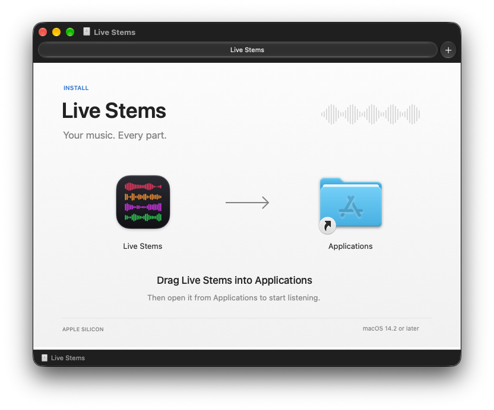

# Drag-to-Applications package



The DMG holds a self-contained Apple Silicon app, an Applications shortcut, and a hidden corresponding-source archive. Python, inference packages, both verified models, and the worker travel inside the app. No runtime package download, Homebrew, compiler, or Terminal command is needed by the listener.

The normal window contains two icons and one instruction. The background is drawn by `dmg-background.swift`; Finder supplies the actual app and Applications icons. `layout.applescript` fixes their positions. Open-source licences remain in the app. The source archive can also be opened with Finder's Show Hidden Files shortcut.

## Build

Use a relocatable CPython 3.12 installation (for example, a uv-managed standalone Python). Do not use a Homebrew framework prefix or a virtual environment. The packager copies this prefix and fixes its internal dylib references. It never changes the source Python installation.

Prepare the exact wheels named in `runtime-lock.json` with the standalone Python's pip:

```sh
python3.12 -m pip download --only-binary=:all: --platform macosx_14_0_arm64 \
  --python-version 312 --implementation cp --abi cp312 --dest /path/to/wheels \
  demucs-mlx==1.5.3 mlx==0.32.3 mlx-metal==0.32.3 mlx-audio-io==1.3.24 \
  mlx-spectro==0.9.10 numpy==2.5.4 packaging==26.3 tqdm==4.70.1
```

The packager checks every wheel against its pinned SHA-256 before installation. It uses pip to install into the bundle without resolving or fetching further packages. Keep the Python prefix's original licence and all dependency metadata.

Run from a checkout:

```sh
python3 script/package_release.py \
  --output /path/to/fresh-release-folder \
  --python /path/to/standalone-python-prefix \
  --wheels /path/to/wheels \
  --models /path/to/model-cache \
  --identity 'CODE_SIGNING_IDENTITY'
```

The model cache must contain the existing `htdemucs` and `htdemucs_ft` safetensors and config files. Each weight file is checked against the digest in its config. The packaged cache is read-only so worker verification stamps cannot alter the signed app. `-I -B` isolates the worker from user Python packages and prevents bytecode writes.

The command builds, packages, signs nested code before the app, audits embedded Mach-O minimum versions and absolute dependencies, checks the app signature, imports bundled inference modules, creates and lays out a writable disk image, converts it to a compressed image, and verifies the image. Failed outputs are retained for diagnosis. Use a fresh output directory for another attempt. The command does not stop, install, or launch Live Stems. It briefly opens its mounted image in Finder to set the layout, then detaches that image in a finally block.

`binary-audit.json` records the embedded native-code targets. The app and all embedded native libraries must target macOS 14.2 or earlier. This static check does not replace running the final app on macOS 14.2. Recheck MLX wheels when updating: a build on a newer Mac can otherwise select newer-platform wheels.

Check the real app after packaging or relocation:

```sh
python3 script/check_bundle.py "/path/to/Live Stems.app"
```

This loads both models, sends a synthetic stereo tone through each worker, checks finite nonzero four-stem output, shuts the workers down, checks that no model stamps were written, and verifies the app signature again. It uses the GPU but does not launch the app or capture audio.

## Public distribution

A locally signed or ad hoc DMG is a preview, not a public release. Developer ID signing, hardened runtime with the tested entitlements, notarization, and stapling are still required for a normal Gatekeeper launch on another Mac. `Apple Development` is not a substitute for `Developer ID Application`. Do not tell users to remove quarantine or disable Gatekeeper.

Before publication, validate model startup and separation from a relocated, read-only app, the complete pitch/seek verification suite, live source recovery, and macOS 14.2 on real hardware. Sign every embedded native module with the release identity; test the hardened runtime configuration before notarization. Attach the exact source archive and licences to the same release. Check source and relinking obligations for all binary dependencies, including the LAME and libsoxr components inside mlx-audio-io; the app source archive alone does not settle those obligations. Never publish a DMG built from a dirty source snapshot without recording the revision and changes.

## Licence

Live Stems is GPL-2.0-or-later. Rubber Band uses GPL-2.0-or-later; libsamplerate uses BSD-2-Clause. The pinned upstream audio sources and notices are in `Sources/PitchCore/vendor`. Python and inference libraries retain their own licences in the bundle. Meta's Demucs models are under MIT; `DEMUCS-LICENSE` accompanies them. The local source archive includes the app, build scripts, and pinned audio source needed to build the app; the runtime lock and build procedure identify the separate Python dependencies.
